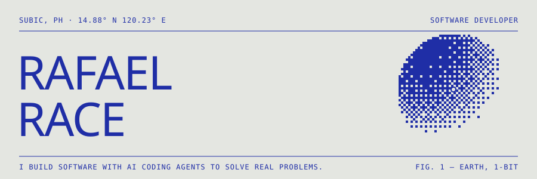

<a href="https://rhaprace.github.io/"></a>

<p align="center">
  <a href="https://rhaprace.github.io/">Portfolio</a> &nbsp;·&nbsp;
  <a href="https://linkedin.com/in/rafael-race-54033719b">LinkedIn</a> &nbsp;·&nbsp;
  <a href="mailto:rhap.dev@gmail.com">rhap.dev@gmail.com</a>
</p>


I build software with AI coding agents to solve real problems for real people. I plan the work, direct Claude Code, and review and test every change before it ships. Code the next person, including future me, can read and change without friction.

```
Role        Software Developer
Based       Subic, Philippines
Education   BS Information Technology, 2026
Principle   Clarity over cleverness
```


          


**Framesports.ai** — Software Developer · Sports video analytics · Remote · Dec 2025 – Oct 2026

Owned features end to end for a rugby video-analytics platform, from the support ticket to the live release.

- **Gave coaches one place to track player growth.** Built a Development page that shows each player's strengths, what to work on, and whether they watched the clips their coach sent.
- **Opened competition stats to the public.** Built a page anyone can open, with no account needed, where a governing body shares player stats for one competition. It shows only fields cleared as public.
- **Gave new clubs a guided start.** Shipped a six-step setup checklist that gives clubs free credits when they finish.
- **Turned a recurring support question into one step.** Coaches kept asking how to get their club treasurer to pay for a Season Pass. Now they send an invite from the packages page and the treasurer pays directly.
- **Stopped clubs losing footage when they switched cameras.** Clubs can now connect Hudl, Veo, YouTube and Google Drive at the same time. Before, adding a source deleted the old one.
- **Removed a manual setup step for clubs.** Framesports now sends each Veo or Hudl club its connection invite for them.


`01 · PUBLIC SAFETY · 2025`<br/>
**[Yanig](https://yanig.vercel.app/)** — Earthquake safety app for the Philippines. Live quakes from USGS, GeoNet and BMKG, Drop-Cover-Hold steps, a go-bag checklist and offline pages, in English and Tagalog.

`02 · DEVELOPER TOOLS · 2025`<br/>
**[env-validator-zero](https://github.com/rhaprace/env-validator-zero)** — Zero-dependency TypeScript library that checks env vars against a schema before an app starts. On npm.

`03 · DEVELOPER TOOLS · 2025`<br/>
**[fetchpilot](https://github.com/rhaprace/fetchpilot)** — Typed `fetch` wrapper with retries, backoff, JSON parsing and consistent errors.

`04 · MEDIA · 2026`<br/>
**[video-generator](https://github.com/rhaprace/video-generator)** — Topic in, narrated 45–60s mp4 out: AI script, TTS voice, stock footage, ffmpeg.


<p align="center"></p>

<picture>
  <source media="(prefers-color-scheme: dark)" srcset="https://raw.githubusercontent.com/rhaprace/rhaprace/output/github-snake-dark.svg" />
  
</picture>

<p align="center"><sub><code>MAKE IT WORK · MAKE IT RIGHT · MAKE IT FAST · MAKE IT BEAUTIFUL</code></sub></p>
